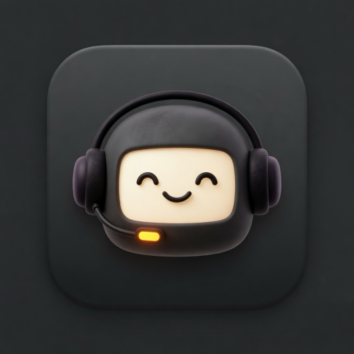
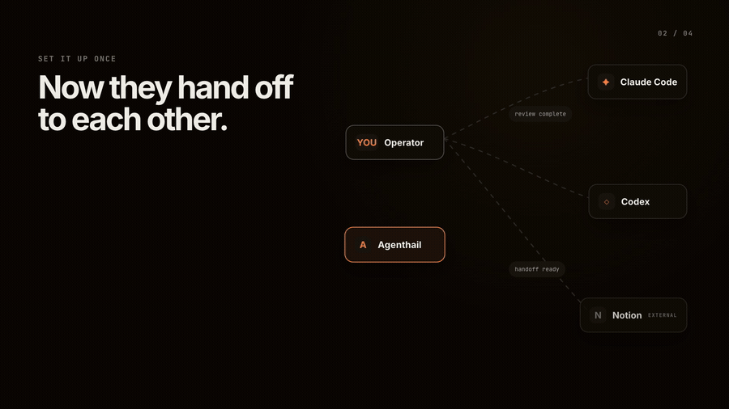

# agenthail

<p align="center">
  
</p>

**Your agents are already working. Agenthail helps them work together.**

[](https://github.com/zm2231/agenthail/actions/workflows/release.yml)   

Agenthail connects the Claude Code, Codex, and Notion conversations you already use. It gives them one shared place to pass work, keep going, and stay reachable when you leave your desk.



## The problem

Your work is split across agents that cannot see each other.

Claude Code is investigating in one window. Codex is building in another. A Notion thread holds the research. Each one knows its own assignment, but none of them knows what happened next door.

You become the connection layer. You read one answer, decide who needs it, switch windows, paste it over, and remember which agent is still working. When you step away, that coordination stops.

Agenthail connects those pieces. It gives you one view of what is running, a way to reach every conversation, and handoffs that keep moving without you copying messages around.

## Install

Agenthail supports Apple silicon Macs and, as a headless daemon, [Linux](#linux). Download the latest `Agenthail-*-arm64.pkg` from [GitHub Releases](https://github.com/zm2231/agenthail/releases), open it, then run:

```bash
agenthail doctor
```

The package installs the Mac app, menu bar item, and command line tool. Agenthail opens automatically and stays ready in the background.

On macOS, agents that Agenthail runs act with the privacy permissions of **Agenthail Daemon**, the background part of Agenthail. Desktop automation such as agent-hands needs Accessibility, Screen Recording, and Automation of Codex Computer Use. `agenthail permissions` shows each one, granted or missing, and the System Settings pane that changes it. `agenthail permissions request` has macOS ask for the missing ones. Settings > Overview in the Mac app shows the same. The permissions stay granted across updates.

Homebrew is also available:

```bash
brew install zm2231/tap/agenthail
brew services start agenthail
```

To update:

```bash
agenthail update --check
agenthail update
```

An update that changes the registry's schema first copies it to `~/.agenthail/registry-before-v<N>.db` (the last two are kept). If you go back to an older Agenthail, it refuses the newer registry and prints the steps to restore that copy; anything changed since the update is lost.

To remove a package installation, run `sudo agenthail-uninstall`. Your local conversations, queue, and history are preserved unless you add `--purge-data`.

### Linux

Agenthail runs on Linux (amd64 and arm64) as a headless daemon for Claude Code and Codex. It needs systemd and installs in your home directory without root:

```bash
tag=$(curl -fsSL https://api.github.com/repos/zm2231/agenthail/releases/latest | sed -n 's/.*"tag_name": *"\([^"]*\)".*/\1/p') && arch=$(uname -m | sed 's/x86_64/amd64/;s/aarch64/arm64/') && name=agenthail-$tag-linux-$arch && cd "$(mktemp -d)" && curl -fsSLO "https://github.com/zm2231/agenthail/releases/download/$tag/$name.tar.gz" -O "https://github.com/zm2231/agenthail/releases/download/$tag/$name.tar.gz.sha256" && sha256sum -c "$name.tar.gz.sha256" && tar -xzf "$name.tar.gz" && test ! -e ~/.local/share/agenthail && mkdir -p ~/.local/share ~/.local/bin && mv "$name" ~/.local/share/agenthail && ln -sfn ~/.local/share/agenthail/agenthail ~/.local/bin/agenthail
agenthail daemon install
agenthail doctor
```

`daemon install` starts a systemd user service, `agenthail.service`, and turns on lingering so the daemon keeps running after you log out. If it prints `linger: off`, run `sudo loginctl enable-linger $USER`; until then systemd stops the daemon at logout and `agenthail doctor` reports it as unhealthy. Restarting or updating the daemon leaves the agents it started running. `agenthail update` installs new releases in place and restores the previous version if the new daemon does not answer.

Run `daemon install` from the shell your agents use: the service records that shell's `PATH`, `CODEX_HOME` and `CLAUDE_CONFIG_DIR`. `CODEX_HOME` must be on a filesystem that can run programs, because Codex's app-server daemon installs and runs its own binary there; `agenthail doctor` flags one that cannot. Claude Remote Control and Notion need a signed-in desktop browser and helper components that the standard Linux download does not include, so a standard Linux install leaves them out; an install that supplies those components can turn Notion on.

Developing Agenthail itself? See the [maintainer documentation](docs/maintainers/).

## Connect your apps

Each app connects independently. If you do not use Notion, it simply stays out of the way. If one app needs attention, the others keep working.

### Claude Code

Agenthail discovers open Claude Code sessions through their local messaging sockets. Native messages require the Agenthail daemon and do not need browser cookies or Remote Control. Sessions that expose only a Remote Control bridge use that transport; enable it with `/rc` in Claude when needed. What you type in Agenthail reaches a terminal Claude as your own turn only through Remote Control; over the socket alone it is a note from Agenthail. To start Remote Control in every new session, run `agenthail hooks install --remote-control on` (or `off`), which sets `remoteControlAtStartup` in each Claude config root and keeps every other setting, or use **Claude Remote Control at startup** in the Mac app's General settings, which sets it per config folder. Sessions already running keep what they started with. Without the flag, `hooks install` leaves the setting alone and says so once when a root has it unset; `hooks status` and `agenthail doctor` show it per root. An install without Remote Control, such as the standard Linux download, refuses the flag. A settings file that is not valid JSON is refused, never overwritten.

A Claude session ID is the conversation ID, the name Claude gives the transcript (`projects/<project>/<session-id>.jsonl`). The process, its messaging socket and its Remote Control session are attachments that come and go; aliases, queues and routes stay with the conversation. `/branch` and `/clear` start a new conversation and therefore a new session with no alias; a branch records the session it was forked from as `forkedFrom`. Only `agenthail identify` moves an alias.

Agenthail reads Claude Code's config root: `CLAUDE_CONFIG_DIR` when set, otherwise `~/.claude`. To include sessions kept in other Claude config folders, list their roots in `~/.agenthail/config.json` as `{"claudeConfigDirs": ["/Users/me/.claude-work"]}`. Each session is sent to, stopped and resumed in the root it lives in. `agenthail doctor` shows every root, and a conversation found in two roots is refused rather than guessed.

`agenthail roots` lists each root with the login it currently holds, the browser sign-in profile signed into that login, and the login's current plan usage from claude.ai. Sign-in and usage need a signed-in browser on that host and the Remote Control helper components; on a host without them, such as a standard Linux server install, `roots` says so and shows the login alone. A root is a config folder, not an account: `/login` can change its login at any time, and every session of the root, running ones included, uses the new login from its next request on. Each root has a name: `default` for the primary, otherwise the folder name (`~/.claude-work` is `claude-work`, and `~/.work/.claude` is `work`; roots that share a folder name are told apart by their parent folders, as in `personal/claude` and `work/claude`). Start a session in another root with `agenthail thread create claude "task" --root claude-work`; `--root` also takes the root's path. A session that names no root starts where the host's policy points: the preferred root while it is under both usage ceilings (90% of the session and of the week by default), otherwise the claude.ai root with the most headroom, otherwise the one whose limit frees up first. A root through an account proxy competes with the readings of the proxy's freest account, and a preferred proxy root is kept even when every account behind it is full. A root that uses an API key is chosen only when it is the preferred one, and a signed-out root never. With one root, with the policy off, or with no other claude.ai root to choose, sessions start in the primary as before. The CLI, the dashboard and the apps say which root was chosen and why; their new-session forms show the choice as **Automatic** before you start. `agenthail roots policy` shows the policy and its next pick, and `roots policy auto off`, `prefer claude-work` or `ceilings 80 95` change it; the dashboard's settings page edits the same values. `list --wide`, the dashboard and the apps show the config folder each Claude session lives in, and their new-session forms offer the same choice. `agenthail usage`, the Mac status strip, the iPhone session list and the dashboard's top bar show every account's limits on every connected host, with the sessions running on each.

If your Claude Code or Codex requests go through an account proxy ([CLIProxyAPI](https://github.com/router-for-me/CLIProxyAPI)), add it with `agenthail proxies add shared http://proxy.example:8317 --key-file ~/.config/agenthail/shared-proxy.key`. The config stores where the proxy's management key is kept (a file only you can read, a keychain item or an environment variable), never the key. Roots whose base URL is the proxy's are shown as going through it, and every surface above shows the proxy's accounts as one group: each account's usage against the proxy's own ceilings, which accounts are cooling or disabled, and the sessions using the proxy on every host. A host without the key shows the group read by a paired host that has one; the key never leaves the machines you put it on. Agenthail only reads the proxy; the proxy still picks the account for each request. `agenthail proxies` lists proxies and their health. See [account proxies](docs/maintainers/proxies.md).

To run a Claude conversation that is open in a terminal or a `claude --bg` job in Agenthail's own host instead, use `agenthail thread adopt <session>`, or **Open in Agenthail** on the session in the Mac app and in the iPhone app's session details. The conversation keeps its history, name, alias, queued messages and config folder. A busy session is never interrupted: one running a turn, waiting on a question or permission, or running a background task is refused, or waited on with `--wait 10m`. A terminal process is stopped only with `--stop-terminal`, or after the apps ask.

`agenthail claude settings compact` shows when Claude compacts conversations under each root, as the root's `settings.json` says, and `agenthail claude settings compact 300000 --root claude-work` (or `--model claude-opus-5-5 auto`, `unset`, `--enabled off`, `--idle off`) changes it there, keeping every other setting. The dashboard's settings page edits the same values. These are the config roots on the machine the command or daemon runs on; to change another host's, run the command there or use that host's daemon (`GET, POST /api/v1/claude/compact-settings`). Claude reads the file when a session starts, so a change applies to sessions started after it; a session Agenthail hosts reports the window it actually compacts at as `contextUsage.autoCompact`.

When Claude refuses a turn because a usage limit was reached, the session shows it as a notice with the time the limit resets, rather than as Claude's reply. `send --reply` and `send --stream` fail with the limit and the reset time.

A session a usage limit stopped resumes on its own once the limit resets, whether the refused turn was the agent's own work, a queued message or a prompt you typed. Messages queued for it wait for the reset instead of being refused. When the reset comes, its queued messages are sent; a session with none is sent `Your usage limit has reset. Continue the work that was interrupted.`, which the session shows as Agenthail's notice rather than as your words. Sessions on one Claude config root share its limit and resume one at a time, 30 seconds apart. A turn on that root that succeeds before the stored reset, as when the root's login changed, resumes them at once. When Claude did not say when the limit resets, one session tries once an hour, up to six times, and the rest follow once it succeeds. A stop not resumed within a day of its reset stays stopped. A session that finished its work before the limit is never resumed. Only the computer that runs a session resumes it.

`agenthail limit-resume` lists the stopped sessions and when they resume. `agenthail limit-resume cancel <target>` keeps one stopped until you resume it, and `agenthail limit-resume resume <target>` resumes it now; the dashboard and the apps offer both on the session. `agenthail limit-resume off`, or the setting in the dashboard and the Mac app, stops sending the notice; queued messages still wait for the reset and are then sent.

The daemon automatically registers up to 112 agents as individual Claude peers, busy agents first and then those most recently active within the last 24 hours, refreshing every 30 seconds. They appear in Claude's `ListAgents` as `agenthail/<surface>: <name>`. Claude can reply to them using native `SendMessage`; Agenthail puts those messages in its durable queue. Any other agent registers automatically on its next outbound send; a send never waits for a free peer slot. Peers outside the registered set retire 24 hours after their last send. Read-only agents can be discoverable, but inbound messages to them are denied and recorded in history.

Use `--from @alias` or `--from surface:session-id` to identify the sender. Without an explicit `--from`, Agenthail resolves the sender in this order: `AGENTHAIL_SESSION_ID`, `CLAUDE_CODE_SESSION_ID`, then `CODEX_THREAD_ID`, read when the command runs. Claude Code sets `CLAUDE_CODE_SESSION_ID` in every command it runs, so a command run after `/branch` or `/resume` speaks for the conversation that is running now. Agents that Agenthail starts never inherit these variables from the process that started them. Without any of these, the message is sent as the Agenthail CLI: a Codex session sees it marked `[from Agenthail CLI, no reply route]`, a Claude session sees a peer named Agenthail CLI, and nothing reads replies to it. A message you write in an Agenthail app is sent as you. Where it cannot be your own turn in the session, it starts with a line naming you and saying you read the reply there. `agenthail person name "<name>"`, or **Your name** in the Mac app's General settings, sets the name sessions on that computer see; without it, your account's full name is used. The iPhone app shows each paired computer's name under Settings and says where to change it. If one of them names a session this Agenthail does not know, such as a session of another Agenthail that ran the command with a scratch `HOME`, the command refuses and names the variable, the registry it checked, and the two ways out: `--from` with one of its sessions, or unsetting that variable and any later one in this order that is also set, to send without a reply address.

Daemon restart, package replacement and an earlier crash do not require manual socket cleanup. Agenthail reconciles only artifacts it can prove belong to its peer workers, preserves foreign or ambiguous sockets, and resolves the target Claude process and socket again for every delivery.

```bash
agenthail send claude:<session-id> "Here are the findings" --from @builder --json
agenthail history @builder 25
```

A socket acknowledgement means transport acceptance, not model completion. Claude's inbound policy can still hold or deny the message: a session that runs without permission prompts holds a message unless its sender states that it does too. A session the Claude host runs states its own mode when it messages another; other senders state none. A held message is listed among delivery problems with its cause, and its agent sender is told. Native sends do not support `--reply`, `--stream`, or slash commands; read the transcript with `last` or receive a native `SendMessage` reply. Compact, model, interrupt, and steer are typed controls. They require the target session to have a live Remote Control attachment, except that a session the Claude host runs takes interrupt, steer and model through the host, and they are never placed in the ordinary message queue. Over Remote Control, a model change and an interrupt are confirmed only by Claude's response to that exact request, and an interrupt also by the turn ending. A steer is reported as accepted, not delivered, because Claude does not confirm it reached the running turn. `agenthail control <target> context|usage|status|effort|rename` runs one of those Claude commands and shows its output.

A message you type in the web dashboard or the Mac or iPhone app, or speak to a session by voice, is your own turn, so Claude records it as yours rather than a peer message. The apps mark it with `"author": "person"` on the `send` action. A session the Claude host runs takes it through the host, and so does an exited session, which resumes in the host. A running session with Remote Control takes it through that attachment. A running session with only a native socket receives it over the socket, as a note from Agenthail rather than your turn; the composer says so and names what would make it your turn: `/remote-control` in the session's terminal where this install has Remote Control, and in the Mac and iPhone apps **Open in Agenthail**. A send that does not declare an author, including any script calling the API, and all agent, relay, channel and CLI sends, use the native socket whenever the session has one. Sessions that expose only Remote Control receive every send through it, as before. A steer you send from the composer is also your own turn. A composer message to a busy session follows your busy-delivery setting, and a queued one is still delivered as your turn.

### Codex

Agenthail drives Codex conversations through Codex Desktop when it is open and through Codex's own app-server daemon when it is not, so the same commands work on a machine without Codex Desktop:

```bash
agenthail thread create codex "Draft the release notes" --alias notes --json
agenthail send @notes "Make it shorter"
```

The dashboard and the Mac app create conversations the same way. When a conversation needs the daemon and it is not running, Agenthail starts it with `codex app-server daemon start`. Codex 0.163 and later install what the daemon needs on first start; older versions ask for the standalone runtime (`curl -fsSL https://chatgpt.com/codex/install.sh | sh`), which Agenthail reports and never installs itself. Turns run inside Codex, so they keep going when Agenthail restarts.

Codex runs slash commands only in its own composer, so Agenthail refuses a message such as `/status` or `/my-skill` instead of passing it to the model as plain text. Invoke a skill with `$my-skill`. A path such as `/tmp/build.log` at the start of a message is sent as written.

A conversation created in Codex Desktop stays with Desktop. Start Desktop with `agenthail launch codex`; Agenthail then uses a loopback-only bridge to the app-server that already owns those conversations. If Codex is already open, quit it and run that command before using Desktop message controls. While Desktop is closed, its conversations are read only in Agenthail, and Agenthail never loads them into the daemon, because a loaded thread locks Desktop out for up to 30 minutes.

For an interactive terminal on the daemon, run `agenthail codex` in a project folder. If the terminal closes before its first message, the conversation still takes a first message from Agenthail until Codex unloads it, after 30 idle minutes by default. Codex keeps nothing for a conversation that never had a message, so Agenthail then marks it offline and leaves it out of the current session list.

If a writer lock outlives the process that held it, Agenthail reports an ownership conflict instead of retrying. After confirming no `agenthail codex` terminal is active, run `agenthail codex --repair-managed-runtime`. That restarts only Codex's app-server daemon; it never restarts Codex Desktop.

### Notion

Notion is optional. It works as an external workspace for research, notes, and longer-running threads. Sign into Notion in your default browser and Agenthail finds those threads and can start new ones. Notion needs a browser on the computer that runs Agenthail, so a server without one, such as a standard Linux install, leaves it out.

### Browser sign-in

Notion and Claude sessions reached over Remote Control authenticate with browser cookies. By default they use your system default browser and the profile it last used: Local State's last used profile for Chrome, Brave, Arc, Chromium and Edge, the default profile in profiles.ini for Firefox, and Safari's single profile. Nothing else reads cookies.

```bash
agenthail signin list                      # what each consumer reads, and the profiles on this computer
agenthail signin add chrome "Profile 2" --label Work
agenthail signin use notion Work           # pin Notion to that profile
agenthail signin use claude auto           # back to the system default browser
agenthail signin use claude none           # turn Claude Remote Control sign-in off
```

Claude Remote Control reads cookies per account: a session's requests use the profile signed into claude.ai as the account of the Claude config root that holds it, trying the profile `signin use claude` chose first, so with two Claude accounts add a profile signed into each. Signing a root into another account with `/login` disconnects Remote Control in that root's running sessions; `/remote-control` in a session starts it again under the new account.

`signin list`, `agenthail doctor`, Settings > Browser Sign-in in the Mac app and the web dashboard, and Settings on iPhone all show the profile each consumer resolves to. If it cannot be read they say why and how to fix it. Safari keeps its cookies in a protected folder, so on macOS reading them needs Full Disk Access for Agenthail Daemon (`/Library/Application Support/Agenthail/Agenthail Daemon.app`) in System Settings > Privacy & Security > Full Disk Access. Supported browsers are Chrome, Brave, Arc, Chromium, Edge, Firefox and Safari.

## One place to check in

The web dashboard and the Mac app show what is working now, what is waiting, and what needs you. The dashboard runs on every computer that runs Agenthail, Linux included: `agenthail dashboard enable` turns it on, and `agenthail dashboard` signs a browser in with a one-time link: macOS opens it in your browser, and elsewhere it is printed for you to open. From another device, use [`agenthail dashboard remote`](#stay-connected-from-your-phone). Open a conversation to read the transcript, send the next instruction, steer the current turn, stop it, compact it, or change models when that conversation supports it. A Codex conversation that Codex already has open, in Desktop or its app-server daemon, takes a new model with its next turn sent through Agenthail, and shows it as "from next turn" until then; a turn started from Desktop's own composer or its queue runs on the model Desktop shows.

The same actions are available from the command line:

```bash
agenthail list
agenthail send @writer "draft the explanation" --reply
agenthail steer @builder "keep the example, cut the setup"
agenthail queue @reviewer "check the final implementation"
agenthail history @writer 25
agenthail search codex "quarterly planning"
```

`agenthail list` requires the daemon and shows its Current catalog, including mirrors. `--recent` adds activity from the last 24 hours; `--running`, `--all`, and `--archived` select the other daemon scopes. All covers catalog history, not every saved registry record; use `search` for provider history. The output names conversation and session totals separately and renders the daemon's status text. `--json` includes the canonical view, counts, ordering, and display instants. [Scope and display contract](docs/maintainers/session-presentation-design.md).

When an agent is already working, Agenthail queues the next message by default. Set
the daemon/dashboard `busyDelivery` setting to `steer` to steer busy targets that
advertise that capability; unsupported targets remain queued. An agent's message to
a Claude session with a native messaging socket goes over that socket even while
it works or waits on you, with the sender's name and reply address; Claude reads it
when the turn can. Use `queue` to make it wait for the turn to end, and `steer`
when you want an explicit active-turn control.
If Agenthail cannot reach a Codex session before starting a turn, it keeps that message pending and retries safely. A timeout after a turn has started is kept as an explicit unknown outcome instead, so Agenthail never guesses whether to send duplicate work. A queued message never expires: it stays pending until it is delivered, you cancel it, or delivery fails in a way Agenthail can prove. `queue list` shows how long each message has waited and why it is held.

An agent that has asked you something is **waiting on you**, not working. That covers a Claude question (`AskUserQuestion`), plan approval or permission prompt, and a Codex approval or input request. `list`, the dashboard and the apps show "Waiting on you". A Mac running Agenthail, a paired iPhone and each browser with notifications on get one notification per question; Linux has no desktop notifications, so there only a paired iPhone and browsers are notified. A subagent or a one-off Codex run (`codex exec`, Codex's own review threads) never notifies you when it finishes; when it waits on you, the notification opens the conversation that started it. Messages to the agent wait until you answer, even a steer, so nothing lands in the middle of the question. An agent's message to a Claude session with a native messaging socket is the exception: Claude holds it behind the question without answering it. A steer then goes into the turn you answered; an ordinary message waits for the turn to finish. A session Agenthail's Claude host runs asks you through Agenthail: the dashboard shows its tool approvals and questions above the composer, along with an MCP server's request for input as a form of its fields or a link to open, and `agenthail requests <target>` and `agenthail answer <target> allow|always|deny|"answer"` do the same from the terminal. Nothing times out, and nothing is approved for you. `agenthail permission-mode <target> <mode>` switches such a session's permission mode while it runs. A Claude CLI running in a terminal asks you through Agenthail too once you run `agenthail hooks install`. That adds a `PermissionRequest` hook, beside the session-context hooks described under [Start work without opening another window](#start-work-without-opening-another-window), to every Claude config root Agenthail knows (`~/.claude` and each `claudeConfigDirs` entry), keeps every other setting, and reaches sessions that are already running. Each question or approval then shows its text and buttons in the apps and dashboard, and `agenthail requests` and `agenthail answer` work on it. The terminal dialog stays open; whichever answer comes first, from the terminal, Remote Control, another `PermissionRequest` hook (cmux installs one, for example) or Agenthail, is the one Claude takes. Once a prompt is answered anywhere, its notifications are withdrawn from the Mac, the iPhone and browsers. `agenthail hooks uninstall` removes Agenthail's hooks, and `agenthail doctor` reports a config root without them. A session Agenthail can't answer, such as a terminal Claude without the hook, shows a card saying it asks a question or needs your input or approval and that you answer it where the session runs, with **Open session** when Agenthail can focus its terminal. A Claude CLI with a dialog open in its terminal, such as `/model` or a settings review, shows the same card in every session, since only the terminal can close it. Its notification says "asks you a question", "needs your input", "needs your approval" or "has a dialog open in its terminal".

Agenthail keeps current work fast by using Codex's bounded local state. To find an older Codex conversation, use the dashboard search box or `agenthail search codex <query>`; selected results are saved locally for later use.

## Let agents hand work to each other

Give useful conversations short names:

```bash
agenthail identify claude:test-session investigator
agenthail identify codex:test-session-23 builder
```

Naming the same conversation again replaces its previous name.

Then connect them:

```bash
agenthail relay add @investigator @builder 'FAIL|NO-SHIP|root cause'
agenthail relay add @investigator @builder 'READY' --once
agenthail relay add @investigator @builder --when goal_completed
```

When the investigation finishes with something the builder needs, Agenthail passes it across. If the builder is busy, the handoff waits. You can see every handoff and cancel anything that should not go out. A handoff to a closed Claude Code session resumes it and delivers once.

`turn_finished` (the default) forwards each successful matching completion, holding a turn that leaves background work running until that work clears; ambient monitors do not hold it. With `--once` it forwards the latest matching completion. `goal_completed` requires a source with goal support, waits for an explicit completed goal and its final turn, and forwards the latest pending completion once per goal. Active, paused, blocked, missing, or unreadable goals keep the route waiting. The regex filters the selected result; it does not determine whether a goal is complete.

New routes begin after existing provider history. Completion events and provider cursors survive daemon restarts; each route advances only when its queue item and receipt commit together. A busy or offline destination keeps its handoff in the delivery queue until it can be delivered. Active routes remain until explicitly removed; an inactive route whose Claude Code source stays closed for an hour is removed. `relay list --json`, the dashboard, and native handoff controls show the condition, pending event count, and capture/consumption error. Queued means persisted for delivery, not received by the destination. See [relay recovery](docs/maintainers/durable-relays.md).

### Ask for a completion report

Ask an agent you hand work to to end its final message with a completion report: one line of JSON in a fenced `agenthail-report` block saying whether it finished, why it stopped, and which commits and files it touched.

````markdown
```agenthail-report
{"v":1,"status":"blocked","stop":"needsInput","reason":"The retry limit is not specified","commits":["0d825e4d"],"paths":["internal/export/retry.go"],"next":"Choose the retry limit"}
```
````

Read it from the agent's latest reply; the command fails and says why when the reply has no valid report:

```bash
agenthail reply @builder --report
```

`agenthail last @builder 5 --report` lists the reports of the last five exchanges. To keep a long reply from flooding an agent's context, `--max-bytes 4000` caps what `reply` and `last` print and says how much was cut.

With `--json` or `--report`, each turn also reports its state, model, duration and token usage, and lists the fields its provider did not record; Notion records none of them. The [operations skill](skills/agenthail-operations/SKILL.md) gives the schema.

The report is the agent's own claim; check the commits before you rely on them. The [operations skill](skills/agenthail-operations/SKILL.md#completion-report) defines every field. Agents that have the skill write one when they finish dispatched work.

To hand work on only when an agent reports, filter a relay on the report. The first relay passes a finished report to the reviewer; the second tells the lead when the builder is blocked, failed or stopped partway:

```bash
agenthail relay add @builder @reviewer '(?:\A|\n)`{3}agenthail-report\n[ \t\r]*\{[^\n]*"status"[ \t\r]*:[ \t\r]*"done"[^\n]*\}[ \t\r]*\n`{3}[ \t\r\n]*\z'
agenthail relay add @builder @lead '(?:\A|\n)`{3}agenthail-report\n[ \t\r]*\{[^\n]*"status"[ \t\r]*:[ \t\r]*"(?:blocked|failed|partial)"[^\n]*\}[ \t\r]*\n`{3}[ \t\r\n]*\z'
```

Each filter matches only a report that ends the reply, so a report quoted mid-reply, or shown inside a longer code block that closes after it, does not fire it. The filter checks where the report is and finds `"status"` anywhere on its line, including inside a nested value; it does not check the other rules. The receiver checks the report with `agenthail reply @builder --report`, the exact parser, before acting on it.

## Give each project a coordinator

Each project can have one coordinator, the agent you send the project's work to and its other sessions report to:

```bash
cd ~/work/export-service
agenthail coordinator new claude --instructions ~/briefs/coordinator.md
agenthail send @export-service-lead "Ship the export fix and report back"
```

From any session in the project, `agenthail send @lead "..."` reaches that project's coordinator. A folder outside every Git repository and added project has no coordinator; `agenthail project add <folder>` makes it a project.

A message to the coordinator always lands. When it is working, the message steers its current turn if the session can be steered, and otherwise waits in the queue. When its session has ended, Agenthail resumes the same conversation. When the conversation is gone, Agenthail starts a new one in the same folder, with the same agent, model and permission mode. Its first message is your saved instructions, a note saying why it started again, and your message. The reply tells you it started again. Messages still waiting for the old conversation move to the new one.

`coordinator new` defines a coordinator that starts on its first message; `agenthail coordinator set <session>` gives the role to a running session instead, on this machine or a paired host. A project in a repository with a remote has one coordinator across your paired hosts: a second one is refused until you pass `--replace`, and `@lead` from a session on any of them reaches it. `agenthail coordinator` shows the current folder's coordinator, `agenthail coordinator list` shows all of them, and `agenthail coordinator clear` removes the role and leaves the session alone. Sends from the dashboard, the Mac and iPhone apps and notification replies reach the coordinator the same way, because they address its session. See [coordinator](docs/maintainers/coordinator.md).

For a group that needs the same update:

```bash
agenthail channel create launch
agenthail channel add launch @writer
agenthail channel add launch @builder
agenthail channel send launch "The release date moved to Friday"
```

To reach every conversation in a project, address the project by name or id instead of a channel; you need no channel for it:

```bash
agenthail channel send '#agenthail' "Main is frozen until the release is tagged"
```

The message goes to the project's conversations on every paired host that are working or were active in the last day, plus the project's coordinator, and not to the sender. The output lists who got it. The dashboard's project row has a Message button that does the same. A channel cannot take a project's name. If a project appears with the name of an existing channel, sends to that name are refused until you rename the channel with `agenthail channel rename <channel> <new-name>`.

## Start work without opening another window

An agent or script can start a Codex thread or Claude session directly:

```bash
agenthail thread create codex "Implement the verified fix" --alias builder --json
agenthail thread create claude "Investigate the build failure" --alias investigator --json
```

The session starts in your current folder unless you choose another project with `--cwd`. Claude sessions run in the Claude host and support status, logs, stop and resume; logs is what the session's Claude process wrote to stderr while it is open, and `agenthail last` reads the conversation. Codex supports forks, its native input queue, reasoning effort, plan mode, service tier and structured output. These controls are available in the CLI and web dashboard; the Mac app offers one-click forks, the native queue, effort and plan mode; see [session operations](docs/maintainers/session-operations.md) for commands and retry behavior.

Agenthail records who started each session: the agent whose command created it, or you when it came from the dashboard, an app or a terminal with no calling session. `--from @alias` names the creator explicitly. Any agent can ask what it is inside Agenthail:

```bash
agenthail whoami --json   # alias, project, coordinator, who started it, who it reports to, how it reaches you
agenthail help agent      # the same as a short brief with the commands that act on it
```

A session an agent started reports to that agent; one you started reports to the project's coordinator, which also sees every report in history. The brief says whether a question the agent asks reaches you in Agenthail and on your phone, or only tells you so you can answer where the session runs.

A Claude or Codex session doesn't have to ask: it gets the brief when it starts, resumes, clears or compacts, and one line when its alias, coordinator or project changes. A Claude session Agenthail starts gets it on its own; a terminal Claude gets it once you run `agenthail hooks install`, which adds `SessionStart` and `UserPromptSubmit` hooks. A Codex session, whether Agenthail or you started it, gets it once you run `agenthail hooks install codex`. That adds the same two hooks to your Codex config, keeping the rest of it, has Codex trust them, and puts a short Agenthail guide between marker lines in `~/.codex/AGENTS.md` (never a project's `AGENTS.md`). `agenthail hooks uninstall codex` removes exactly those, and `agenthail hooks status codex` and `agenthail doctor` say whether the hooks are installed and trusted. A session Agenthail doesn't know gets nothing.

Notion threads can start the same way:

```bash
agenthail send notion:new:launch-notes "Draft the launch notes" --reply
```

## Stay connected from your phone

The iPhone companion is distributed through TestFlight. [Request an iPhone invite privately](mailto:zainmer@protonmail.com?subject=Agenthail%20iPhone%20TestFlight%20access&body=Please%20invite%20this%20Apple%20Account%20email%3A%20). Publishing the `.ipa` as a normal download would not make it installable on an ordinary iPhone, so TestFlight is the supported path while the app is in beta.

After installing the iPhone app, install Tailscale on the iPhone and on the computer running Agenthail, and sign both into the same account. The phone connects only over Tailscale.

Turn on phone access with `agenthail dashboard remote`, then show a pairing code on that computer and scan it with the iPhone's camera or with **Scan pairing code** in the app:

- In a terminal, including over SSH, run `agenthail devices pair`. It draws the code, prints the link, and waits until the phone pairs.
- In the web dashboard, open Settings > **iPhone app** and choose **Pair an iPhone**. On the iPhone itself, tap **Open in Agenthail** instead of scanning.
- In the Mac app, open Settings > **Devices**, turn on **Phone access**, and choose **Show Pairing Code**.

The iPhone app can then show current work, open conversations, send or steer messages, and notify you when an agent finishes or is waiting on you. `agenthail devices` lists the phones paired with the computer and `agenthail devices remove <device>` disconnects one. The computer is not opened to the public internet.

`agenthail dashboard remote` also prints a sign-in link and QR code for the web dashboard, over the same Tailscale connection. Open it in any browser on a device signed into your Tailscale network, a phone or another computer. Each link signs in one browser, once, within 15 minutes; the browser then appears in `agenthail devices` and can be removed like a phone.

A signed-in browser can be notified too, even with the dashboard closed, with no Mac or iPhone involved: open Settings > **Notifications in this browser** and turn on **Notify this browser**. It gets the notifications a paired iPhone gets, one per question, withdrawn once the question is answered anywhere. Safari keeps a web page's notification in Notification Center even after the page closes it, so in Safari an answered question stays until you clear it, or until Notification Center drops the oldest once a site has about 100. The browser has to reach the dashboard at a secure address, `localhost` on the computer that runs Agenthail or the `agenthail dashboard remote` address from another device. On iPhone and iPad, add the dashboard to the Home Screen first and turn notifications on from there. `agenthail devices` shows whether each browser is notified, and a browser unused for 30 days is signed out and no longer notified.

Matching voice-enabled builds also offer **Talk to orchestrator**: a real Codex
Voice conversation that can inspect agents, delegate work, and read replies through
one persistent operator. [Voice setup, flow, and current limits](docs/maintainers/codex-voice.md).

## See agents on your other machines

Pair the Agenthail daemon on another machine and its sessions appear in the same list, app and phone. Pair as many machines as you like, on macOS or Linux. Paired daemons reach each other over Tailscale, the same private connection the phone uses, so each machine needs Tailscale on a network they share. Run `agenthail hosts invite` there and `agenthail hosts add '<link>'` here, then address its sessions as `server::@builder`. If a machine goes offline, its sessions stay listed as unavailable, and messages to them wait until it returns; they never expire. [How paired hosts work](docs/maintainers/hosts.md).

To continue an idle Claude session on another paired machine, run `agenthail move <session> --to server`. The conversation keeps its id, history, model and permission mode, and from then on it runs there and is listed here as `server::<id>`. Messages queued for it follow it, except one with attached files, which fails and says so. The other machine needs a checkout of the same repository, and the session's working tree must be clean at a commit some remote branch has. A copy of the conversation stays in `agenthail-moved/<id>/<move id>/` under this machine's Claude config root (`~/.claude` by default) for recovery by hand; nothing reads it. If the other machine stops answering mid-move, the session waits, with no machine writing to it, until it answers again (`agenthail move list --unfinished`). [How a move works](docs/maintainers/host-move.md).

## What Agenthail remembers

Agenthail keeps a local record of messages it moved, work still waiting, retries, failures, and automatic handoffs. The Audit view makes it possible to come back hours later and understand what happened.

```bash
agenthail queue list
agenthail queue list --mine
agenthail queue list --cwd /workspace/agenthail
agenthail queue retry 12
agenthail queue rm 12
agenthail history --json
```

Your full transcripts remain in the apps that created them. Agenthail keeps only the local information it needs to coordinate delivery and show the audit trail.

## Privacy

There is no Agenthail account and no telemetry.

Your conversations and history stay on the machine that runs Agenthail. Phone access is private to your Tailscale network. If you enable iPhone notifications, Agenthail sends only the connected app name and a completion or failure status through Apple. Browser notifications carry the same, encrypted so only that browser can read it, through the push service of the browser's maker, such as Google, Mozilla or Apple. It never puts an agent name, conversation title, reply text, or browser sign-in data in a notification.

Read the full [security and privacy model](SECURITY.md).

## Help and deeper documentation

- `agenthail doctor` checks connection and current-session discovery. Each delivery also checks that the target can accept input immediately before a turn starts.
- [Native Mac and iPhone apps](docs/native-apps.md)
- [Appearance with ui.conf](docs/ui-conf.md)
- [Security and privacy](SECURITY.md)
- [Maintainer documentation](docs/maintainers/)

## License

Source-available under the [PolyForm Noncommercial License 1.0.0](LICENSE). Personal, research, educational, nonprofit, and other noncommercial use are permitted under its terms. Commercial use needs a separate license: see [COMMERCIAL.md](COMMERCIAL.md) or contact [zainmer@protonmail.com](mailto:zainmer@protonmail.com).
